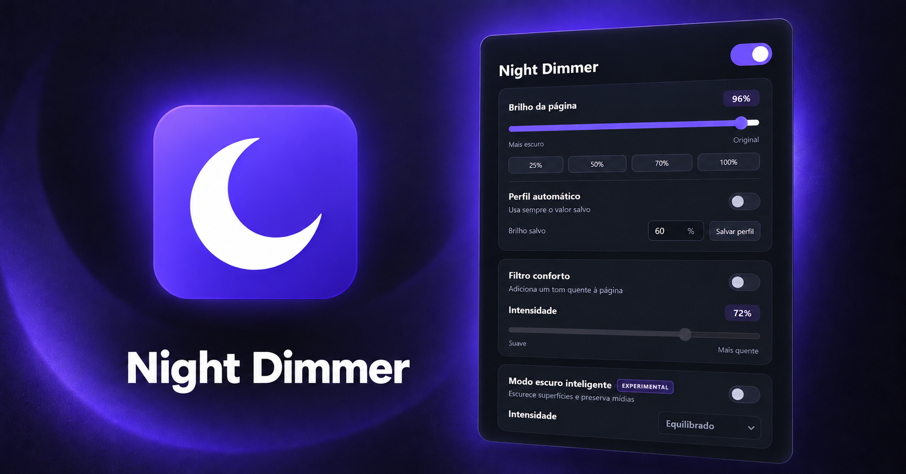
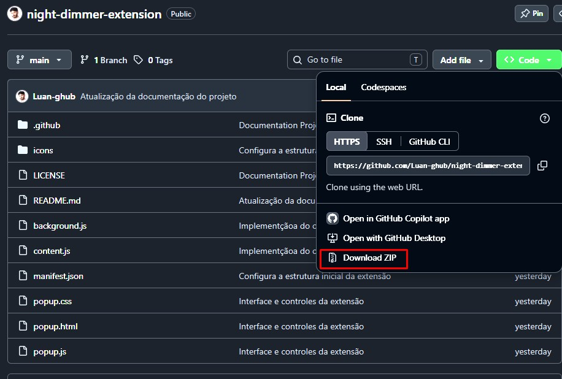
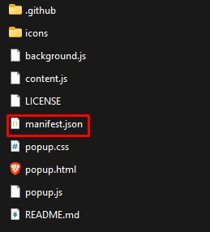
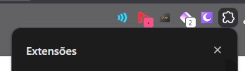
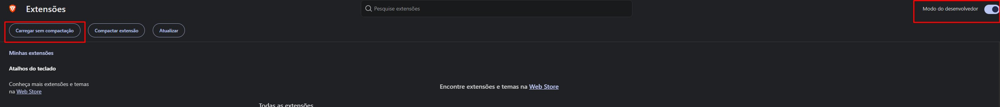
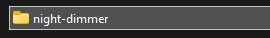
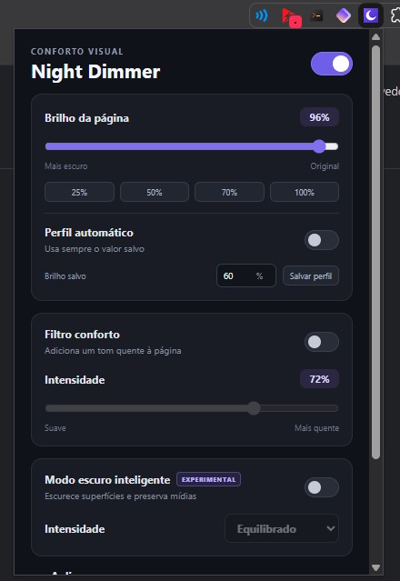

# Night Dimmer

Extensão Chromium Manifest V3 para controle de brilho, filtro de conforto, perfil automático e modo escuro inteligente aplicados em abas do navegador. Os recursos podem ser aplicados em uma aba, em abas selecionadas ou em todas as abas.

## Apoie o projeto

Se o Night Dimmer for útil para você, considere apoiar o projeto:

<a href="https://buymeacoffee.com/luan_grm">
  
</a>

---

# Recursos

### Brilho da página

- Controle manual entre 10% e 100%.
- Atalhos para 25%, 50%, 70% e 100%.
- Perfil automático com porcentagem personalizada.

### Filtro conforto

Adiciona uma camada quente regulável, semelhante a filtros de leitura ou luz
noturna. O efeito não altera fisicamente a temperatura de cor do monitor, e é aplicado apenas nas guias do navegador

### Modo escuro inteligente

Analisa as cores calculadas dos elementos da página e tenta: converter superfícies claras em superfícies escuras, clareando textos que perderiam contraste e adaptando bordas. O modo ainda está em regime experimental, pois tenta preservar imagens, vídeos, canvas e SVG e acompanhar elementos adicionados dinamicamente, mas possui algumas falhas a depender do site acessado.

O recurso é reversível e oferece três intensidades: **Suave**, **Equilibrado** e **Intenso**. 

### Aplicação por abas

- **Somente nesta aba:** aplica na aba ativa no momento da configuração.
- **Abas selecionadas:** mostra as guias da janela atual com favicon, título,
  domínio, último acesso e controle individual de brilho.
- **Todas as abas:** aplica em abas compatíveis de todas as janelas.

A lista de abas pode ser expandida verticalmente arrastando sua borda inferior.
Cada guia mantém sua própria configuração durante a sessão. As preferências também
são salvas por site e reaplicadas quando ele é aberto novamente.

## Privacidade e permissões

As configurações são armazenadas localmente pelo navegador. A extensão associa as
preferências ao endereço de origem do site, sem salvar conteúdo das páginas. Ela não
envia dados para serviços externos e não coleta o histórico de navegação.

- `storage`: salva as preferências de brilho e conforto visual;
- `tabs`: permite selecionar em quais abas os efeitos serão aplicados;
- `scripting` e acesso às páginas: aplicam os efeitos nas abas escolhidas.

## Como instalar

1. No GitHub, selecione **Code > Download ZIP** e extraia o arquivo.

   <p align="center">
     
   </p>

2. Confirme que o arquivo `manifest.json` está diretamente dentro da pasta extraída.

   <p align="center">
     
   </p>

3. Abra o gerenciamento de extensões do navegador.

   <p align="center">
     
   </p>

4. Ative o **Modo do desenvolvedor**, normalmente localizado na parte superior da página.

   <p align="center">
     
   </p>

5. Clique em **Carregar sem compactação**.

   <p align="center">
     
   </p>

6. Selecione a pasta `night-dimmer` inteira, sem abri-la, e confirme o carregamento.

   <p align="center">
     
   </p>


Obs: 

- Não abra a pasta do night-dimmer para anexa-la ao navegador, pois irá apresentar erro, a pasta deve ser apenas selecionada e carregada por inteiro.


## Limitações

- Navegadores Chromium não permitem alterações em páginas internas (`brave://...`, `chrome://...`, `edge://...`), lojas de extensões e alguns visualizadores protegidos.

- O modo escuro inteligente pode produzir resultados imperfeitos em algumas páginas. O ajuste de brilho e de conforto ocular permanece mesmo que ele seja desativado.

- Elementos exibidos em tela cheia pelo próprio site podem ocultar temporariamente os filtros da extensão.

## Atualização 3.2.0

- configurações independentes para cada aba;
- aplicação automática ao alternar ou recarregar guias;
- recuperação das preferências salvas ao reabrir um site.

### Atualização 3.1.0

- controle individual de brilho para cada aba selecionada.

### Atualização 3.0.2

- reforço da validação das mensagens internas;
- correção da seleção de abas entre diferentes janelas;
- redução de sincronizações e processamentos repetidos;
- início desativado e limitado à aba atual em novas instalações.

## Estrutura do projeto

```text
night-dimmer/
├── manifest.json
├── background.js
├── content.js
├── popup.html
├── popup.css
├── popup.js
├── icons/
│   ├── icon16.png
│   ├── icon32.png
│   ├── icon48.png
│   └── icon128.png
├── .github/
├── LICENSE
└── README.md
```

## Licença

O projeto é disponibilizado sob a [licença MIT](LICENSE).
